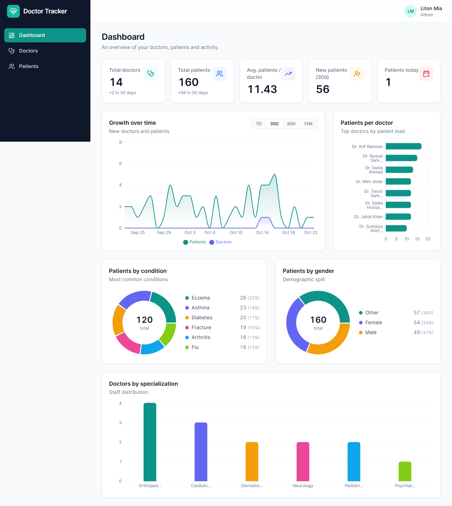
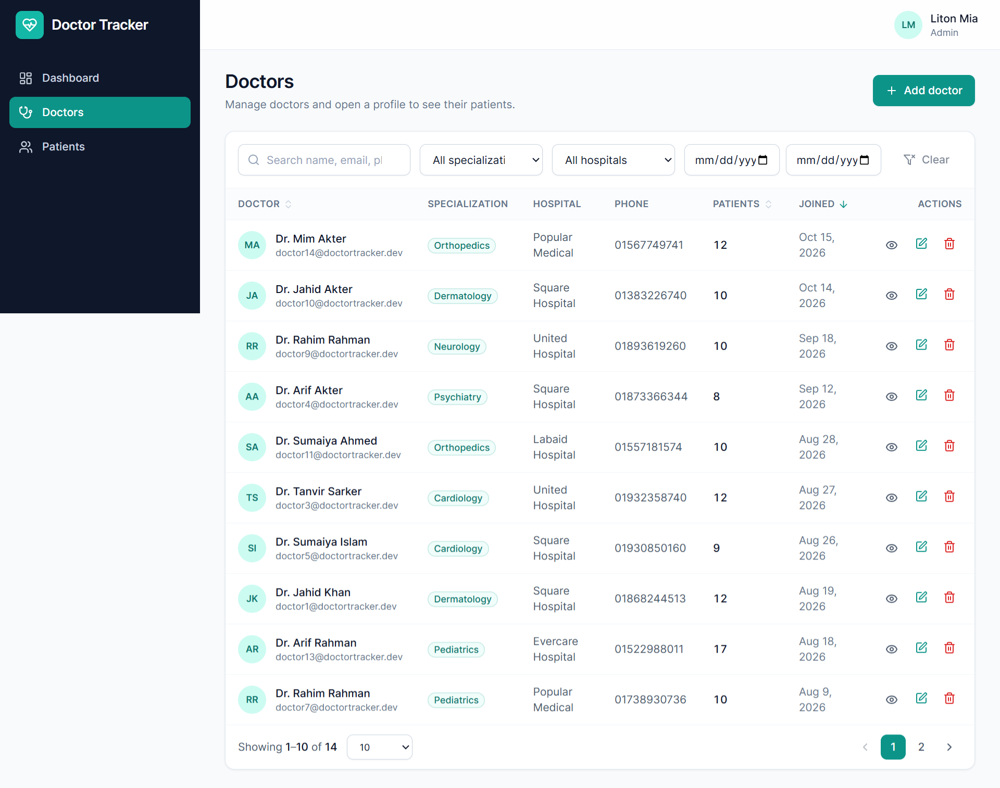
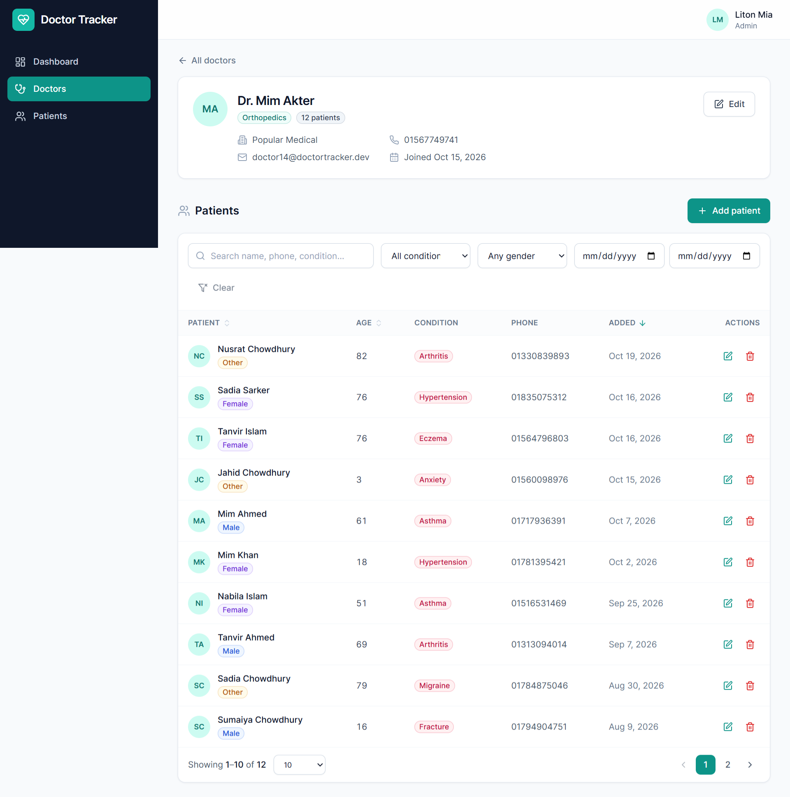
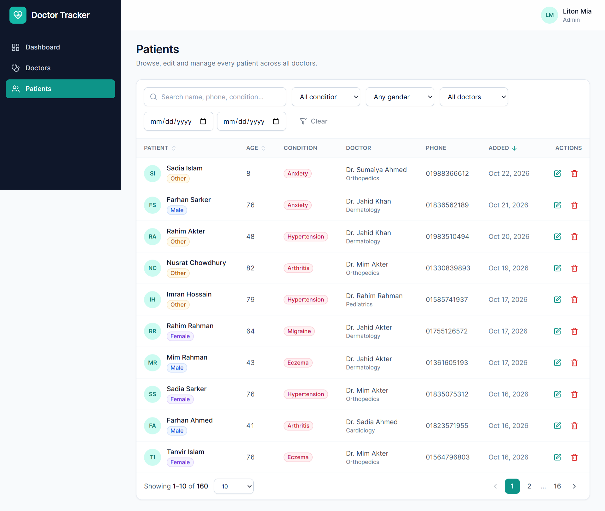
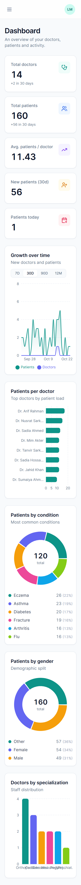
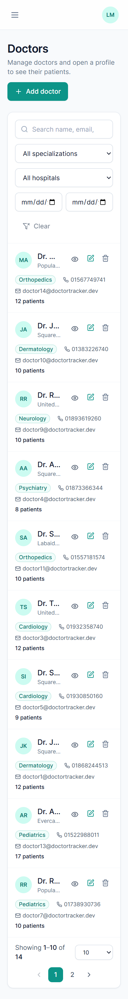
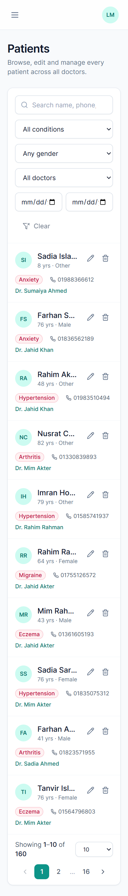

# Doctor Tracker — Frontend

## Description

Doctor Tracker is a secure admin portal for managing doctors and their patients. This repository is the Next.js client: a responsive, accessible UI with authenticated routes, searchable/filterable/paginated tables for doctors and patients, per-doctor patient management, and a dashboard of analytics charts. It talks to the standalone Express + MongoDB API (`doctor-tracker-backend`) over REST.

## Tech Stack

Next.js 14 (App Router) · TypeScript · Tailwind CSS · Redux Toolkit + RTK Query · React Hook Form + Zod · Recharts · Sonner · Lucide icons

## Setup Guide

Prerequisites: Node.js >= 18.18 and the backend running (see its README).

```bash
# 1. Start the backend first (default http://localhost:5000)

# 2. Install dependencies
npm install

# 3. Configure environment (API_URL must point at the backend; set it BEFORE building)
cp .env.example .env

# 4. Run
npm run dev                     # http://localhost:3000

# Production
npm run build && npm start
```

Sign in with the admin created by the backend on first start (default `admin@gmail.com` / `admin@123`). Run `npm run seed:sample` in the backend to populate demo data for the charts. The portal is restricted to the `ADMIN` role: other accounts are rejected at login.

`.env.example`:

| Variable | Purpose |
|---|---|
| `API_URL` | Backend origin. **Read at build time** (Next.js bakes rewrites into the build), so set it before `npm run build`. Never exposed to the browser. |

## Project Structure

```
src/
├── app/                     routes (App Router)
│   ├── login/               public sign-in page
│   └── (app)/               authenticated area (AuthGuard + AppShell)
│       ├── dashboard/       analytics
│       ├── profile/         edit my own details and photo
│       ├── doctors/         list + [id] detail with the doctor's patients
│       └── patients/        global patient list
├── components/
│   ├── ui/                  Button, Field, Modal, Card, Badge, Pagination, Skeleton…
│   ├── common/              SearchInput (debounced), DateRangeFilter, SortHeader, ErrorState
│   ├── layout/              Sidebar, Topbar, AppShell, AuthGuard
│   ├── dashboard/           StatCard, ChartCard, Recharts wrappers
│   ├── doctors/ patients/   feature tables, filters and form modals
├── services/                RTK Query API slices (auth, doctors, patients, dashboard)
├── store/                   Redux store, typed hooks, UI slice
├── hooks/                   useDebounce, useListParams, useDoctorOptions
├── lib/                     utils, API error helpers
├── types/                   shared domain types
└── middleware.ts            edge route protection
```

## System Architecture

```
Browser ──▶ Next.js (UI, middleware) ──rewrite /api/v1/*──▶ Express API ──▶ MongoDB
   ▲                 │
   └── httpOnly cookie (first-party: set through the proxy)
```

1. **Route protection (two layers).** `middleware.ts` redirects requests without the `accessToken` session cookie to `/login?next=…` before any protected UI renders. `AuthGuard` then verifies the session with `GET /auth/me` and signs out non-`ADMIN` accounts. A 401 from any call clears the cookie via the API and redirects to login (no redirect loops).
2. **Data flow.** Pages hold filter state locally (`useListParams`: page, search, filters, sort). Changing any filter resets to page 1. The state is the argument of an RTK Query hook, so each distinct combination is cached and deduplicated; the previous page stays visible (dimmed) while the next loads.
3. **Mutations.** Create/update/delete calls invalidate coarse tags (`Doctor`, `Patient`, `Dashboard`), so lists, per-doctor counts and charts refresh automatically.
4. **Forms.** React Hook Form + Zod mirror the backend validation. Server-side field errors (`422 details`) are mapped back onto the matching inputs.

## Technical Decisions

### 1. RTK Query for server state instead of hand-rolled fetching or Context

Almost all state in this app is server state: paginated lists, filter options and aggregates. RTK Query gives caching, request deduplication, loading/error flags and tag-based invalidation without writing reducers or `useEffect` fetchers. Because each query argument is a plain serializable object (`page`, `search`, filters…), switching filters and returning to a previous view is instant from cache. Redux itself only holds the small amount of true client state (mobile sidebar). Context was rejected because it re-renders every consumer on any change and offers no caching. Trade-off: invalidation is coarse (by type), which refetches slightly more than strictly necessary but guarantees counts and charts are never stale after a write.

### 2. Same-origin API proxy (Next.js rewrites) with an httpOnly cookie

The browser only calls `/api/v1/*` on the Next.js origin, which forwards to the backend. The auth cookie is therefore first-party: JavaScript can never read the token (XSS-resistant), there is no CORS configuration, no `SameSite=None`, and the edge middleware can see the cookie to protect routes. Trade-off: one extra network hop in production; if you need to avoid it, deploy both services behind one domain/reverse proxy.

## Profile Photos

Admins, doctors and patients all have an optional profile photo. Doctor and patient forms and the `/profile` page use a shared `ProfileImageInput` (preview, change, remove, undo, 2MB / JPG-PNG-WebP validation before upload). Saves are sent as `multipart/form-data` (`lib/formData.ts`); the `Avatar` component shows the photo and falls back to initials when there is none or the image fails to load. Image URLs come from the API (`<BACKEND_URL>/uploads/...`) and load directly in the browser, so the backend's `BACKEND_URL` must be a public address.

## UX & Performance Notes

- Debounced search (400 ms), keyed list items, skeleton loaders, optimistic dimming during refetch, empty and error states with retry.
- Desktop tables collapse into cards on mobile; modals become bottom sheets; the sidebar becomes a drawer.
- Accessible by default: labelled controls, `aria-sort` on sortable headers, focus rings, Escape-to-close dialogs, `role="alert"` on errors.
- Charts are code-split into the dashboard route only.

## Known Limitations

- Doctor dropdowns (patient form, filters) load up to 100 doctors, the backend's page-size cap. For larger rosters, replace with an async search combobox.
- Only the `ADMIN` role can use the portal (enforced by the API and the login/guard checks); there is no per-role UI beyond that.
- In production the API sets `Secure` cookies, so serve both the frontend and the proxy target over HTTPS.

## Visual Evidence

### Desktop

| Dashboard | Doctors |
| --- | --- |
|  |  |

| Patients | Doctor detail |
| --- | --- |
|  |  |

### Mobile

| Dashboard | Doctors | Patients |
| --- | --- | --- |
|  |  |  |
